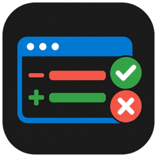
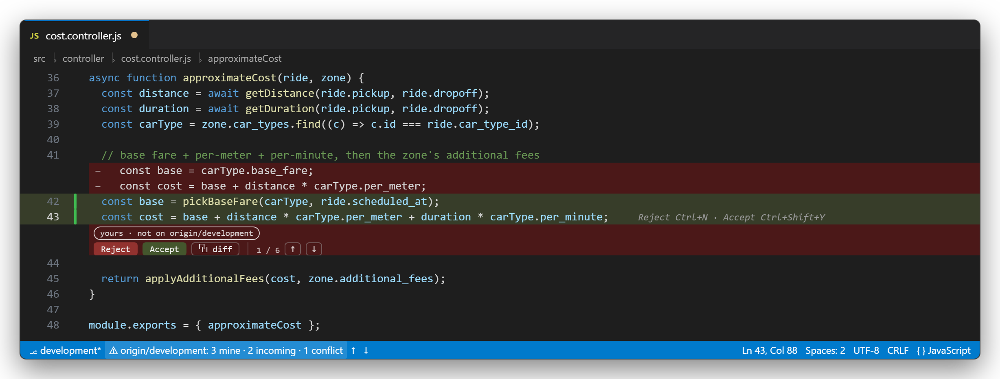
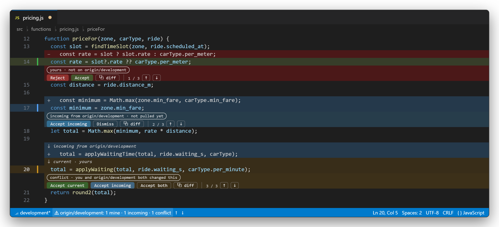
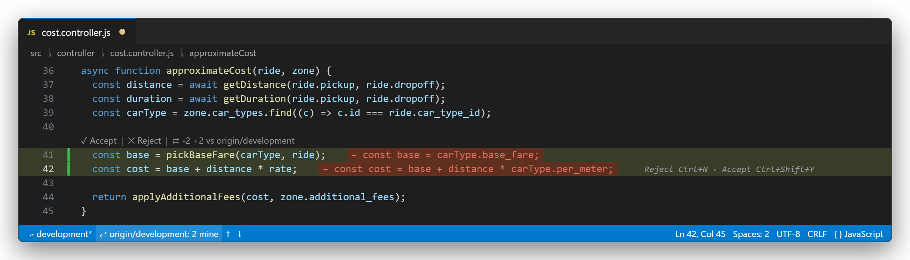
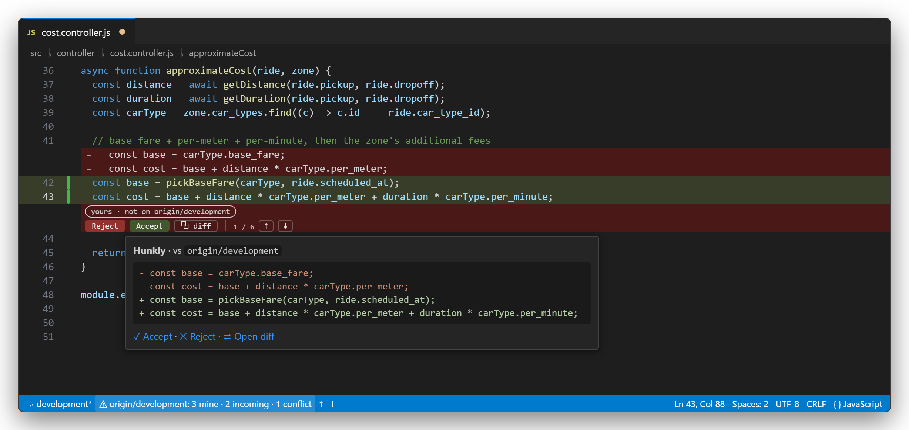
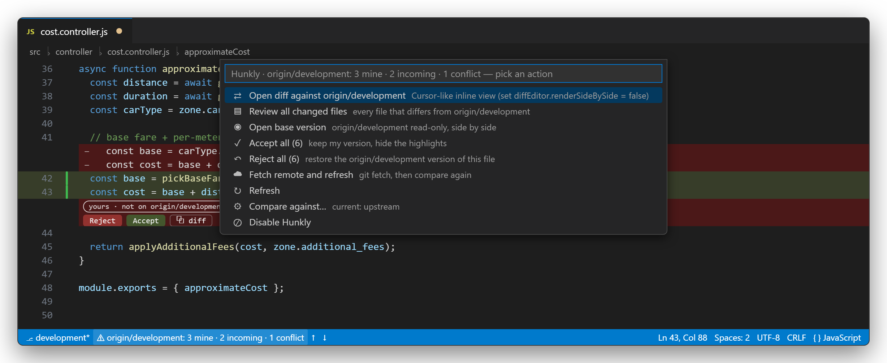

<p align="center">
  
</p>

<h1 align="center">Hunkly</h1>

<p align="center">
  <b>Accept / Reject every git change right inside the editor — Cursor style.</b><br>
  See what changed in the open file compared to <b>GitHub</b> (<code>origin/&lt;branch&gt;</code>), <code>HEAD</code> or the index:<br>
  removed lines as red rows, added lines in green, and one click (or one key) per hunk.
</p>

<p align="center">
  <a href="https://marketplace.visualstudio.com/items?itemName=Ghammes.hunkly"></a>
  <a href="https://marketplace.visualstudio.com/items?itemName=Ghammes.hunkly"></a>
  <a href="https://marketplace.visualstudio.com/items?itemName=Ghammes.hunkly&ssr=false#review-details"></a>
  <a href="https://github.com/AhmedMohamed652000/vscode-git-inline-diff/blob/main/LICENSE"></a>
</p>



## Why Hunkly?

`git diff` tells you *that* a file changed. A diff editor shows it in another tab. Hunkly shows it **in the file you are editing**, hunk by hunk, with the decision right there:

- **Red rows** right above your change are the lines you removed or replaced (the GitHub version).
- **Green lines** are what you wrote. Blue and orange mark what *teammates* pushed and real conflicts (see below).
- **Accept** keeps your version and hides the highlight (remembered per workspace until the hunk changes).
- **Reject** puts the GitHub lines back into the file. It is a normal edit: `Ctrl+Z` undoes it.
- After each decision the cursor jumps to the next pending hunk, so a whole file can be reviewed from the keyboard alone.
- Compare against the upstream branch (what is on GitHub), `HEAD`, the index, or any ref (`origin/main`, a tag, a sha).
- Nothing is sent anywhere: Hunkly only runs `git` in your repository.

## Mine · Incoming · Conflict

Comparing the working file with the remote mixes two things: what **you** changed, and what **others** pushed that you have not pulled yet. Hunkly uses the merge base of `HEAD` and the base branch to tell them apart and colours every hunk accordingly:



| Kind | Colour | Meaning | `Ctrl+Shift+Y` | `Ctrl+N` |
|------|--------|---------|----------------|----------|
| **mine** | green | only you changed this region since the merge base | **Accept** — keep mine, hide | **Reject** — restore the base lines |
| **incoming** | blue | the remote changed it, your file still has the old lines | **Dismiss** — hide | **Accept incoming** — apply the remote lines |
| **conflict** | orange | both sides changed the same region; a pull will conflict here | **Accept current** — keep mine | **Accept incoming** — take theirs |

A conflict has a third button, **Accept both**: it inserts the GitHub lines above yours and marks the region as reviewed, so you can merge the two by hand (`Ctrl+Z` undoes it).

So `Ctrl+Shift+Y` always means *keep what is in my file* and `Ctrl+N` always means *take the GitHub version of this region*. Incoming hunks are best handled with a real `git pull`; Hunkly shows them so you know you are behind, and lets you take single regions when you want to. When the remote is already merged into `HEAD` (or the base is `head` / `index`) everything is simply "mine". Turn the classification off with `"gitInlineDiff.threeWay": false`.

## Works everywhere — with or without the rows

The red rows are drawn with VS Code's `editorInsets` proposed API, which needs a one-time switch (see [Turn on the rows](#turn-on-the-cursor-style-rows-one-time)). Until then Hunkly shows exactly the same information as **red chips at the end of each changed line, plus a CodeLens with the buttons**:



Prefer this style on purpose? Set `"gitInlineDiff.removedLinesView": "inline"`.

## Hover for the full diff

Hovering a hunk shows the complete `-` / `+` diff with clickable actions, whatever the view style:



## Status bar and menu

The status bar always tells you where you stand — `origin/development: 3 mine · 2 incoming · 1 conflict` — with **↑ ↓** to jump between hunks. Click it for everything else:



## Jumping between changes

- Every action bar ends with a counter (`2 / 5`) and **↑ ↓** buttons that jump to the previous / next change (wrapping around) and give the focus back to the editor.
- After **Accept** / **Reject** the cursor jumps to the next pending change by itself; when the last one is handled the status bar says *reviewed*.
- Keyboard: `F7` / `Shift+F7` (like the diff editor) or `Ctrl+Alt+]` / `Ctrl+Alt+[`.

## Keyboard

| Key | When | Action |
|-----|------|--------|
| `Ctrl+Shift+Y` (`Cmd+Shift+Y`) | cursor inside a hunk | Accept / Dismiss / Accept current, then jump to the next hunk |
| `Ctrl+N` (`Cmd+N`) | cursor inside a hunk | Reject / Accept incoming, then jump to the next hunk (outside a hunk `Ctrl+N` is still *New File*) |
| `F7` / `Shift+F7` | file has hunks | Next / previous hunk |
| `Ctrl+Alt+]` / `Ctrl+Alt+[` | file has hunks | Next / previous hunk |
| `Ctrl+Alt+D` (`Cmd+Alt+D`) | file has hunks | Open VS Code's diff editor against the base |

Change them in *File → Preferences → Keyboard Shortcuts* (search for "Hunkly").

## Turn on the Cursor-style rows (one time)

VS Code only grants the `editorInsets` proposed API to extensions listed in its `argv.json`. Hunkly does that for you:

1. Run **Hunkly: Enable Inline Rows** from the Command Palette (or click *Enable rows* in the prompt Hunkly shows the first time). It adds `"enable-proposed-api": ["Ghammes.hunkly"]` to the editor's `argv.json` and keeps a `.bak` copy.
2. Quit the editor completely (all windows) and start it again. *Reload Window* is not enough.

That is all. Without it Hunkly keeps working with chips + CodeLens.

## The real diff editor is one key away

`Ctrl+Alt+D` (or the compare icon in the editor title, or the status bar menu) opens VS Code's own diff editor against the base, with the real file on the modified side, so the same Accept / Reject keys and the built-in per-hunk revert arrows work there too. **Review All Changed Files** opens every file that differs from the base in the multi-file diff editor.

To make the diff editor inline (unified) instead of side by side:

```json
"diffEditor.renderSideBySide": false
```

## Commands (Command Palette → "Hunkly")

- Accept / Reject Hunk, Accept Both (conflicts), Accept All, Reject All
- Go to Next / Previous Hunk
- Enable Inline Rows (writes `argv.json`, restart required)
- Open Diff Against Base, Open Base Version (read-only)
- Review All Changed Files Against Base (multi-file diff editor)
- Fetch Remote and Refresh (`git fetch`, then compare again)
- Choose What to Compare Against (`upstream` / `head` / `index` / any ref)
- Show Accepted Hunks Again, Refresh, Enable / Disable

## Settings

| Setting | Default | Meaning |
|---------|---------|---------|
| `gitInlineDiff.base` | `upstream` | `upstream` (origin/<branch>), `head`, `index`, or any git ref such as `origin/main` |
| `gitInlineDiff.threeWay` | `true` | classify hunks as mine / incoming / conflict using the merge base |
| `gitInlineDiff.advanceAfterAction` | `true` | jump to the next pending hunk after Accept / Reject |
| `gitInlineDiff.removedLinesView` | `rows` | `rows` = red rows with the buttons under each hunk (needs *Enable Inline Rows* + restart once, falls back to chips until then), `inline` = chips at the end of changed lines + CodeLens, `off` |
| `gitInlineDiff.showCodeLens` | `true` | Accept / Reject / Diff lenses above each hunk (chips style) |
| `gitInlineDiff.removedTextMaxLength` | `200` | cut the inline chip text after this many characters |
| `gitInlineDiff.showGutterIcons` | `true` | green / blue / orange bars in the glyph margin |
| `gitInlineDiff.showKeybindingHint` | `true` | "Reject Ctrl+N · Accept Ctrl+Shift+Y" on the hunk under the cursor |
| `gitInlineDiff.ignoreWhitespace` | `false` | ignore leading / trailing whitespace when comparing |
| `gitInlineDiff.maxLines` | `20000` | bigger files are skipped |
| `gitInlineDiff.exclude` | node_modules, lock files, `*.min.js`, `*.map` | files that are never compared |

## Colours

Every colour follows your theme and can be overridden in `workbench.colorCustomizations`:
`gitInlineDiff.addedLineBackground`, `gitInlineDiff.removedTextBackground`, `gitInlineDiff.removedTextForeground`, `gitInlineDiff.removedMarker`,
`gitInlineDiff.incomingLineBackground`, `gitInlineDiff.incomingTextBackground`, `gitInlineDiff.incomingTextForeground`, `gitInlineDiff.incomingMarker`,
`gitInlineDiff.conflictLineBackground`, `gitInlineDiff.conflictTextBackground`, `gitInlineDiff.conflictTextForeground`, `gitInlineDiff.conflictMarker`,
`gitInlineDiff.hintForeground`.

## Good to know

- "What is on GitHub" means the last fetched state of `origin/<branch>`. Run **Fetch Remote and Refresh** (or enable `git.autofetch`) to pick up new remote commits; incoming hunks appear after a fetch and disappear after a pull.
- Files inside a git submodule are compared against the submodule's own upstream.
- A file that does not exist on the base is reported as *new file* in the status bar and is not painted.
- Accepted hunks are remembered per workspace; **Show Accepted Hunks Again** brings them back.

## Development

```bash
git clone https://github.com/AhmedMohamed652000/vscode-git-inline-diff.git
cd vscode-git-inline-diff
npm install
npm test                    # node test/smoke.js  (fake vscode + throw-away git repo, incl. the three-way scenario)
# F5 in VS Code runs the extension in an Extension Development Host
npx @vscode/vsce package
code --install-extension hunkly-<version>.vsix --force
```

Bugs and ideas: [GitHub issues](https://github.com/AhmedMohamed652000/vscode-git-inline-diff/issues).

---

## بالعربي

Hunkly بيقارن أي ملف بتفتحه بالنسخة اللي على GitHub (`origin/<branch>`) ويعرض الفرق جوّه الملف نفسه:

- زي Cursor بالظبط: السطر القديم **أحمر** فوق، والسطر الجديد **أخضر** تحته، وتحت الـ hunk شريط فيه chip بيقول التغيير ده جاي منين، والأزرار جنبه.
- **تغييرك** أخضر وعليه "yours · not on origin/…" وأزرار **Reject / Accept**. **تغيير جاي من GitHub ولسه ما عملتش pull** أزرق وعليه "incoming from origin/…" وأزرار **Accept incoming / Dismiss**. **تعارض** (انت وهما غيرتوا نفس السطور) برتقالي وعليه "conflict" وأزرار **Accept current / Accept incoming / Accept both**. بيتحسبوا من الـ merge base بين HEAD والفرع.
- حل التعارض: **Accept current** سيب نسختك، **Accept incoming** خد نسخة GitHub، **Accept both** يحط سطورهم فوق سطورك عشان تدمجهم بإيدك. كله تعديل عادي ينفع فيه `Ctrl+Z`.
- `Ctrl+Shift+Y` دايماً = سيب اللي في ملفي، و `Ctrl+N` دايماً = خد نسخة GitHub للمنطقة دي. بعد أي واحدة المؤشر بينط للـ hunk اللي بعده. الـ status bar بيقول مثلاً `origin/development: 3 mine · 2 incoming · 1 conflict`.
- الصفوف الحمرا محتاجة تفعيل مرة واحدة لكل محرر: أمر **Hunkly: Enable Inline Rows** (بيضيف سطر في `argv.json` وبيسيب نسخة `.bak`) وبعدين اقفل المحرر كله وافتحه تاني. قبل التفعيل بيشتغل بنفس المعلومات على شكل chips حمرا في آخر السطر + CodeLens.
- لو وقفت بالماوس على الـ hunk هيظهرلك الـ diff كامل بالـ `-` و `+` ومعاه لينكات Accept / Reject / Open diff.
- `Ctrl+Alt+D` يفتح الـ diff editor بتاع VS Code على نفس الملف لو عايز تشوف الملف كله.
- المقارنة بآخر fetch من الريموت، فلو فيه commits جديدة على GitHub اعمل **Fetch Remote and Refresh** من المنيو في الـ status bar. الـ incoming بيظهر بعد fetch ويختفي بعد pull.
